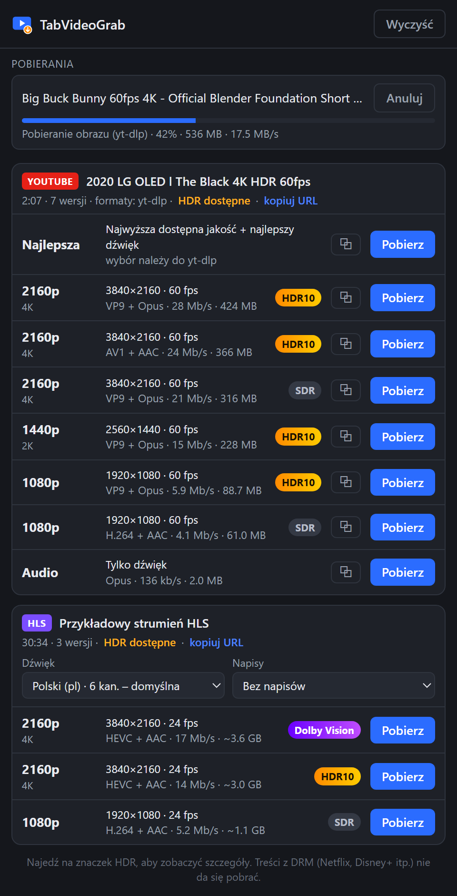

# TabVideoGrab

**English** | [Polski](README.pl.md)

A Firefox add-on that detects video in the current tab, lists the available resolutions with an **HDR10 / HLG / Dolby Vision / SDR** badge, and downloads the version you pick, together with the audio track and subtitles you choose.

<p align="center">
  
  <br><sub>The add-on popup (sample data; the interface is currently in Polish)</sub>
</p>

## Features

- **Video detection** from the tab's network traffic:
  - HLS playlists (`.m3u8`, `.m3u`),
  - DASH manifests (`.mpd`),
  - MP4/WebM/MOV/MKV files,
  - `<video>` elements on the page.

  The number of detected videos is shown on the toolbar icon.
- **Version list** with resolution, frame rate, codec, bitrate and size (exact or estimated).
- **HDR detection** for every version. Hover over the badge to see what the verdict is based on.

  | Badge | Based on |
  |---|---|
  | `HDR10` | `VIDEO-RANGE=PQ`, CICP transfer 16, `colr` box, AV1/VP9 codec string, mastering-display SEI (HEVC) |
  | `HLG` | `VIDEO-RANGE=HLG`, CICP transfer 18 |
  | `Dolby Vision` | `dvh1`/`dvhe`/`dav1` codecs, `SUPPLEMENTAL-CODECS`, `dvcC` box |
  | `SDR` | explicitly SDR, or 8-bit content |
  | `10-bit` / `BT.2020` | 10-bit or BT.2020 colour without transfer info – may be HDR |

- **Audio track and subtitle selection** from drop-down lists when a video has more than one.
- **Downloading:**
  - plain files go through Firefox's download manager;
  - HLS: segments are fetched in parallel, AES-128 is decrypted, and the result is joined into `.ts` or `.mp4` (fMP4);
  - DASH: `SegmentTemplate` (`$Number$`, `$Time$`/`SegmentTimeline`), `SegmentList`, `SegmentBase`.

  Segments are written to disk (OPFS), so large videos don't fill up memory. When video and audio are saved as separate files, the add-on gives you a ready `ffmpeg … -c copy` command to merge them.
- **M3U lists** (IPTV, radio): the add-on lists the entries with a search box, and the **Analyze** button inspects the selected entry (versions, HDR, download).
- **YouTube** via [yt-dlp](https://github.com/yt-dlp/yt-dlp) – see below.

## Installation

### Temporary (quickest)

1. Get the repository (`git clone` or **Code → Download ZIP**).
2. In Firefox, open `about:debugging#/runtime/this-firefox`.
3. Click **Load Temporary Add-on…** and select `manifest.json`.
4. Reload the page with the video and start playback.

An add-on loaded this way is removed when Firefox closes.

### Permanent

Release Firefox only installs signed add-ons. You have two options:

- **Sign it on AMO without publishing:** create API keys at addons.mozilla.org → Developer Hub → *Manage API Keys*, then run:
  ```powershell
  npx web-ext sign --channel=unlisted --api-key=KEY --api-secret=SECRET
  ```
  Drag the `.xpi` from the `web-ext-artifacts` folder into Firefox.
- **Firefox Developer Edition / Nightly / ESR:** set `xpinstall.signatures.required` to `false` in `about:config`, pack the add-on and drag the `.xpi` into the window:
  ```powershell
  Compress-Archive -Path manifest.json,background.js,content.js,lib,popup,icons -DestinationPath TabVideoGrab.zip -Force; Move-Item TabVideoGrab.zip TabVideoGrab.xpi -Force
  ```

## YouTube

YouTube doesn't use standard streams, so it works a little differently:

- **Format list:** first from the player data on the page, then – when the helper is installed – from `yt-dlp -J`, which reports HDR directly.
- **The ⧉ button** copies a ready yt-dlp command with the chosen quality, audio track and subtitles. It works without the helper.
- **The Download button** runs yt-dlp in the background (requires the helper). yt-dlp merges video and audio and saves the file to your *Downloads* folder.
- **Trailer instead of the film.** When a video is Premium-only and YouTube serves its trailer instead, the add-on detects it and won't list or download the trailer as the film.

### Native helper (Windows, one-time setup)

Requirements: Python 3, [yt-dlp](https://github.com/yt-dlp/yt-dlp), [ffmpeg](https://ffmpeg.org/), and ideally [Node.js](https://nodejs.org/) or [deno](https://deno.com/) (yt-dlp needs a JavaScript runtime for YouTube).

In the add-on folder, run:

```powershell
powershell -ExecutionPolicy Bypass -File .\host\install.ps1
```

The script:
- creates `host\vg_host.bat` and `host\tabvideograb.json`,
- adds the registry key `HKCU\Software\Mozilla\NativeMessagingHosts\tabvideograb` (current user only),
- offers to install yt-dlp with winget if it can't find it.

Run it again after moving the folder. To uninstall: `.\host\uninstall.ps1`.

### Settings (`host\config.json`, optional)

```json
{
  "ytdlp": "C:\\tools\\yt-dlp.exe",
  "ffmpeg": "C:\\ffmpeg\\bin\\ffmpeg.exe",
  "outDir": "D:\\Videos",
  "jsRuntime": "node:C:\\Program Files\\nodejs\\node.exe",
  "cookiesFromBrowser": "firefox",
  "cookiesMode": "fallback"
}
```

| Key | Meaning |
|---|---|
| `ytdlp`, `ffmpeg` | paths, if the programs aren't on PATH |
| `outDir` | output folder (default: *Downloads*) |
| `jsRuntime` | JS runtime for yt-dlp. Detected automatically: Node.js or Bun; yt-dlp finds deno on its own |
| `cookiesFromBrowser` | where to take the YouTube session from: `firefox`, `firefox:PROFILE_NAME`, or `""` (never log in) |
| `cookiesMode` | `fallback` (default): log in only when a video needs it (Premium, age-restricted, private, trailer served instead of the film). `always`: always use the session, which also shows the **1080p Premium** format |

## Audio tracks and subtitles

| Source | Audio | Subtitles |
|---|---|---|
| YouTube | dubbed audio tracks | manual and automatic; saved as `.srt` next to the video |
| HLS | `EXT-X-MEDIA TYPE=AUDIO` | `TYPE=SUBTITLES`; WebVTT segments joined into one `.vtt` file |
| DASH | audio sets by language, label and role | WebVTT/TTML (whole files or segmented `text/vtt`) |

## Limitations

- **DRM:** content protected with Widevine, PlayReady or FairPlay (Netflix, Disney+, Prime, films bought on YouTube) is marked "DRM" and not downloaded. The add-on does not circumvent protection.
- **Multi-period DASH** (e.g. with ads): only the first period is downloaded.
- **Live streams:** for HLS, only the part available at that moment is downloaded. Endless streams (radio) keep downloading until you cancel.
- **Merging video and audio:** for HLS/DASH the add-on doesn't merge them; it gives you the ffmpeg command. On YouTube, yt-dlp does it.
- **Native helper:** the install script is Windows-only for now.
- **Interface language:** the popup is currently in Polish.

## Project structure

| File | Purpose |
|---|---|
| `background.js` | detection (webRequest), analysis, download queue, Referer header for CDNs |
| `content.js` | `<video>` elements on the page, YouTube player data |
| `lib/hls.js`, `lib/dash.js` | m3u8/m3u and mpd parsers |
| `lib/probe.js` | MP4/WebM header parsing (`colr`, `hvcC`, `av1C`, `vpcC`, `dvcC`, SEI) |
| `lib/hdr.js` | HDR10 / HLG / Dolby Vision / SDR classification |
| `lib/youtube.js` | YouTube formats, audio tracks and subtitles; yt-dlp commands |
| `lib/sink.js` | segment storage (OPFS or memory) |
| `popup/` | the add-on popup |
| `host/` | native helper (Python, native messaging) and install scripts |

## Disclaimer

This project is meant for saving content you have the right to save: your own, freely licensed, or allowed by the service's terms. You are responsible for how you use it. YouTube's Terms of Service restrict downloading outside the features YouTube provides.
