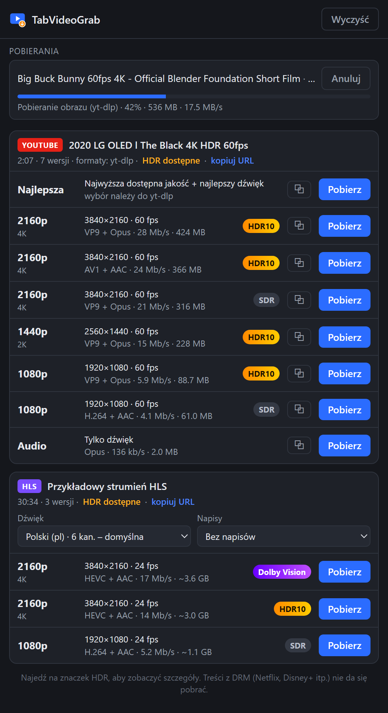

# TabVideoGrab

[English](README.md) | **Polski**

Dodatek do Firefoksa, który wykrywa wideo w bieżącej karcie, pokazuje dostępne rozdzielczości z oznaczeniem **HDR10 / HLG / Dolby Vision / SDR** i pobiera wybraną wersję razem z wybraną ścieżką dźwiękową i napisami.

<p align="center">
  
  <br><sub>Okienko dodatku (przykładowe dane)</sub>
</p>

## Możliwości

- **Wykrywanie wideo** na podstawie ruchu sieciowego karty:
  - playlisty HLS (`.m3u8`, `.m3u`),
  - manifesty DASH (`.mpd`),
  - pliki MP4/WebM/MOV/MKV,
  - elementy `<video>` na stronie.

  Liczba wykrytych filmów pojawia się na ikonie dodatku.
- **Lista wersji** z rozdzielczością, fps, kodekiem, bitrate i rozmiarem (dokładnym albo szacowanym).
- **Rozpoznawanie HDR** przy każdej wersji. Po najechaniu na znaczek widać, skąd wzięła się ocena.

  | Znaczek | Na jakiej podstawie |
  |---|---|
  | `HDR10` | `VIDEO-RANGE=PQ`, CICP transfer 16, pudełko `colr`, ciąg kodeka AV1/VP9, SEI mastering display (HEVC) |
  | `HLG` | `VIDEO-RANGE=HLG`, CICP transfer 18 |
  | `Dolby Vision` | kodeki `dvh1`/`dvhe`/`dav1`, `SUPPLEMENTAL-CODECS`, pudełko `dvcC` |
  | `SDR` | jawnie SDR albo materiał 8-bitowy |
  | `10-bit` / `BT.2020` | 10-bit lub paleta BT.2020 bez informacji o krzywej – może być HDR |

- **Wybór ścieżki dźwiękowej i napisów** z list rozwijanych, gdy film ma ich kilka.
- **Pobieranie:**
  - zwykłe pliki przez menedżer pobierania Firefoksa;
  - HLS: segmenty pobierane równolegle, odszyfrowanie AES-128, sklejanie w `.ts` lub `.mp4` (fMP4);
  - DASH: `SegmentTemplate` (`$Number$`, `$Time$`/`SegmentTimeline`), `SegmentList`, `SegmentBase`.

  Segmenty trafiają na dysk (OPFS), więc nawet duże filmy nie zapychają pamięci. Gdy obraz i dźwięk zapisują się osobno, dodatek podaje gotową komendę `ffmpeg … -c copy` do ich połączenia.
- **Listy M3U** (IPTV, radio): dodatek pokazuje pozycje z wyszukiwarką, a przycisk **Analizuj** sprawdza wybraną pozycję (jakości, HDR, pobieranie).
- **YouTube** przez [yt-dlp](https://github.com/yt-dlp/yt-dlp). Szczegóły w sekcji niżej.
- **Interfejs po polsku i angielsku**, wybierany automatycznie według języka przeglądarki.

## Instalacja

### Tymczasowo (najszybciej)

1. Pobierz repozytorium (`git clone` albo **Code → Download ZIP**).
2. W Firefoksie otwórz `about:debugging#/runtime/this-firefox`.
3. Kliknij **Załaduj tymczasowy dodatek…** i wskaż `manifest.json`.
4. Odśwież stronę z filmem i włącz odtwarzanie.

Tak wczytany dodatek znika po zamknięciu Firefoksa.

### Na stałe

Zwykły Firefox instaluje tylko podpisane dodatki. Są dwie możliwości:

- **Podpis z AMO bez publikacji:** wygeneruj klucze API w addons.mozilla.org → Developer Hub → *Manage API Keys*, a potem:
  ```powershell
  npx web-ext sign --channel=unlisted --api-key=KLUCZ --api-secret=SEKRET
  ```
  Plik `.xpi` z folderu `web-ext-artifacts` przeciągnij do Firefoksa.
- **Firefox Developer Edition / Nightly / ESR:** w `about:config` ustaw `xpinstall.signatures.required` na `false`, spakuj dodatek i przeciągnij plik `.xpi` do okna:
  ```powershell
  Compress-Archive -Path manifest.json,background.js,content.js,lib,popup,icons,_locales -DestinationPath TabVideoGrab.zip -Force; Move-Item TabVideoGrab.zip TabVideoGrab.xpi -Force
  ```

## YouTube

YouTube nie korzysta ze standardowych strumieni, więc działa trochę inaczej:

- **Lista formatów:** najpierw z danych odtwarzacza na stronie, a gdy działa program pomocniczy, z `yt-dlp -J`, który podaje HDR wprost.
- **Przycisk ⧉** kopiuje gotową komendę yt-dlp z wybraną jakością, dźwiękiem i napisami. Działa bez programu pomocniczego.
- **Przycisk Pobierz** uruchamia yt-dlp w tle (wymaga programu pomocniczego). yt-dlp łączy obraz z dźwiękiem i zapisuje plik w folderze *Pobrane*.
- **Zwiastun zamiast filmu.** Gdy film jest dostępny tylko dla Premium, a YouTube podsuwa zamiast niego zwiastun, dodatek to rozpoznaje i nie pokazuje ani nie pobiera zwiastuna jako filmu.

### Program pomocniczy (Windows, jednorazowo)

Wymagania: Python 3, [yt-dlp](https://github.com/yt-dlp/yt-dlp), [ffmpeg](https://ffmpeg.org/), a najlepiej też [Node.js](https://nodejs.org/) lub [deno](https://deno.com/) (yt-dlp potrzebuje środowiska JavaScript do obsługi YouTube).

W folderze dodatku uruchom:

```powershell
powershell -ExecutionPolicy Bypass -File .\host\install.ps1
```

Skrypt:
- tworzy `host\vg_host.bat` i `host\tabvideograb.json`,
- dodaje wpis `HKCU\Software\Mozilla\NativeMessagingHosts\tabvideograb` (tylko dla bieżącego użytkownika),
- proponuje instalację yt-dlp przez winget, jeśli go nie znajdzie.

Po przeniesieniu folderu uruchom skrypt ponownie. Odinstalowanie: `.\host\uninstall.ps1`.

### Ustawienia (`host\config.json`, opcjonalnie)

```json
{
  "ytdlp": "C:\\narzedzia\\yt-dlp.exe",
  "ffmpeg": "C:\\ffmpeg\\bin\\ffmpeg.exe",
  "outDir": "D:\\Filmy",
  "jsRuntime": "node:C:\\Program Files\\nodejs\\node.exe",
  "cookiesFromBrowser": "firefox",
  "cookiesMode": "fallback"
}
```

| Klucz | Znaczenie |
|---|---|
| `ytdlp`, `ffmpeg` | ścieżki, jeśli programy nie są w PATH |
| `outDir` | folder zapisu (domyślnie *Pobrane*) |
| `jsRuntime` | środowisko JS dla yt-dlp. Domyślnie wykrywane: Node.js lub Bun, a deno yt-dlp znajduje sam |
| `cookiesFromBrowser` | skąd brać sesję YouTube: `firefox`, `firefox:NAZWA_PROFILU` albo `""` (bez logowania) |
| `cookiesMode` | `fallback` (domyślnie): logowanie tylko, gdy film go wymaga (Premium, wiek, film prywatny, zwiastun zamiast filmu). `always`: zawsze z sesją, dzięki czemu widać też format **1080p Premium** |

## Ścieżki dźwiękowe i napisy

| Źródło | Dźwięk | Napisy |
|---|---|---|
| YouTube | ścieżki z dubbingiem | ręczne i automatyczne; zapisywane jako `.srt` obok filmu |
| HLS | `EXT-X-MEDIA TYPE=AUDIO` | `TYPE=SUBTITLES`; segmenty WebVTT sklejane w jeden plik `.vtt` |
| DASH | zestawy audio według języka, etykiety i roli | WebVTT/TTML (całe pliki lub segmentowane `text/vtt`) |

## Ograniczenia

- **DRM:** treści zabezpieczone Widevine, PlayReady lub FairPlay (Netflix, Disney+, Prime, filmy kupione na YouTube) są oznaczane jako „DRM” i nie są pobierane. Dodatek nie obchodzi zabezpieczeń.
- **DASH z kilkoma okresami** (np. z reklamami): pobierany jest tylko pierwszy okres.
- **Transmisje na żywo:** z HLS pobierany jest fragment dostępny w danej chwili. Strumienie bez końca (radio) pobierają się, dopóki ich nie anulujesz.
- **Łączenie obrazu z dźwiękiem:** dla HLS/DASH dodatek tego nie robi, tylko podaje komendę ffmpeg. Na YouTube robi to yt-dlp.
- **Program pomocniczy** ma na razie skrypt instalacyjny tylko dla Windows.

## Budowa

| Plik | Rola |
|---|---|
| `background.js` | wykrywanie (webRequest), analiza, kolejka pobierania, nagłówek Referer dla CDN |
| `content.js` | elementy `<video>` na stronie, dane odtwarzacza YouTube |
| `lib/hls.js`, `lib/dash.js` | parsery m3u8/m3u i mpd |
| `lib/probe.js` | odczyt nagłówków MP4/WebM (`colr`, `hvcC`, `av1C`, `vpcC`, `dvcC`, SEI) |
| `lib/hdr.js` | klasyfikacja HDR10 / HLG / Dolby Vision / SDR |
| `lib/youtube.js` | formaty, ścieżki i napisy YouTube; komendy yt-dlp |
| `lib/sink.js` | zapis segmentów (OPFS lub pamięć) |
| `lib/i18n.js`, `_locales/` | tłumaczenia (angielski, polski) |
| `popup/` | okienko dodatku |
| `host/` | program pomocniczy (Python, native messaging) i skrypty instalacji |

## Zastrzeżenie

Projekt służy do zapisywania materiałów, do których masz prawo: własnych, udostępnionych na wolnych licencjach albo takich, na których pobranie pozwala regulamin serwisu. Za sposób użycia odpowiada użytkownik. Regulamin YouTube ogranicza pobieranie poza funkcjami udostępnionymi przez serwis.
